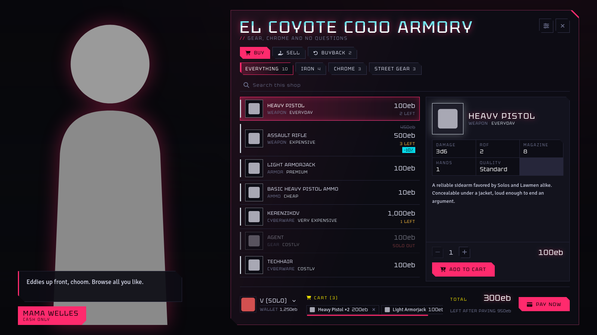
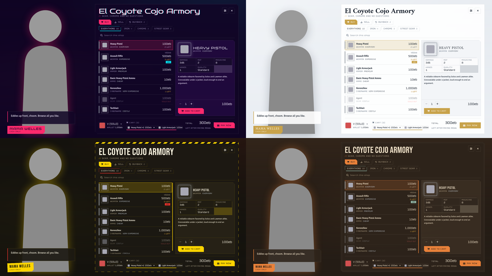
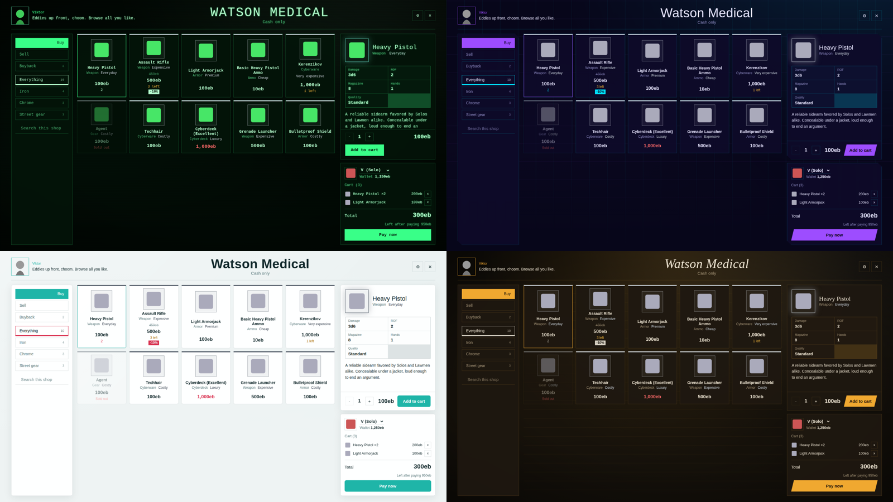
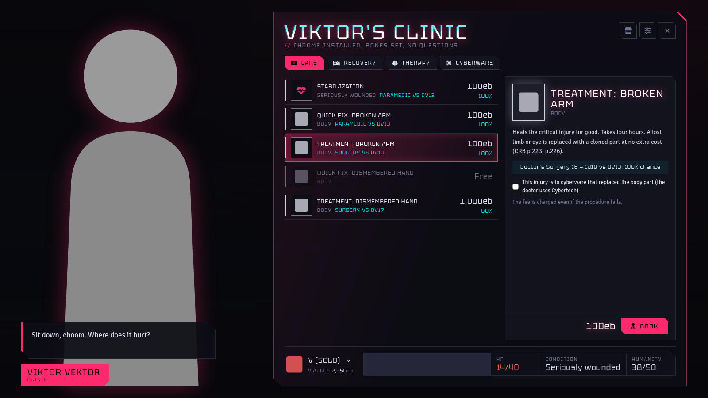
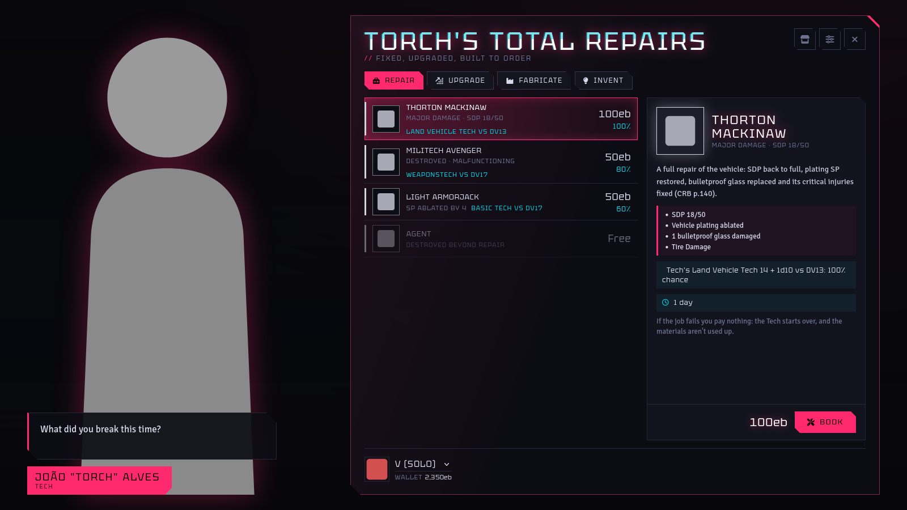

# Neon Market: Themed Shops for Cyberpunk RED

Full-screen, themed shop encounters for the **Cyberpunk RED - CORE** system on Foundry VTT.
Put a clerk on stage, stock the shelves by drag and drop, and let players buy, sell and buy back
with eurobucks that land in the CPR wealth ledger.

| Requirement | Version |
| --- | --- |
| Foundry VTT | v12 (built with v13+ APIs in mind, see below) |
| Cyberpunk RED - CORE | 0.92 (verified against 0.92.4 source) |





## Install

**From a manifest URL (recommended, gets automatic updates):** in Foundry's setup screen open
*Add-on Modules*, click *Install Module*, paste the manifest URL from the project's release page
and click *Install*. See [PUBLISHING.md](PUBLISHING.md) for the URL format.

**By hand:** unzip `module.zip` into your Foundry `Data/modules/cpr-neon-market/` folder, so you
end up with `Data/modules/cpr-neon-market/module.json`.

Then open your world and enable **Neon Market** in *Manage Modules*.

## Set up a shop (GM)

1. Open shop settings from any of these:
   - the **Neon Market** button in an actor sheet header, then **Store**,
   - right-click the actor in the Actors sidebar, then **Neon Market settings** and **Store**,
   - the sliders button in the Token HUD, then **Store**.
2. **Identity:** tick *Open for business*, name the shop and clerk, pick clerk art (a tall
   transparent portrait works best) and write what the clerk says.
3. **Look:** choose a theme. New shops start on **Night City chrome**, the look of
   [Neon Hub](https://github.com/choccoops/neonredlanding)'s calendar. Picking a theme also sets its layout and colors;
   change them afterwards if you like.
4. **Catalog:** drag items or item folders from the sidebar or a compendium onto a category.
   Leave *Price* blank to use the item's market price. *Stock* -1 means unlimited.
   *Copy this actor's items* turns the actor's own inventory into a category with matching stock.
5. **Audio / Trading:** music, sound effects, sell rate, buyback and shop cash.
6. Click **Preview** to see changes live while you edit, then **Save**.

Any actor can host a shop: an NPC, a container, even a player character. The shop catalog is
separate from the actor's own inventory and wallet.

## Open a shop

- **Players:** select your token, walk it next to an NPC shopkeeper and press **G**
  (change the key in *Configure Controls*; set the distance in module settings).
- **GM, Token HUD:** one button opens what the actor offers: its clinic, else its tech shop, else its
  store (each window links to the others). The sliders button opens the settings, and for stores the
  bullhorn button **shows the shop on every player's screen**. Players don't get HUD buttons; they use **G**, which only reaches NPCs (actors no player owns), or a tile or macro you set up.
- **Macro / API:**

```js
const api = game.modules.get("cpr-neon-market").api;
api.open(actorOrUuid);            // open for yourself
api.present(actorOrUuid);         // GM: open on all players' screens
api.present(actorOrUuid, [userId]); // GM: only these users
api.dismiss(actorOrUuid);         // GM: close it everywhere
api.configure(actorOrUuid);       // GM: open the editor
await api.getShop(actorOrUuid);   // read the shop config
```

## How trades work

Players can't write to an NPC they don't own, so every trade is sent to the active GM's client,
which checks prices and stock itself (it never trusts the player's numbers), then:

1. takes or pays eurobucks through the CPR ledger,
2. adds or removes the items (stackables like ammo merge into existing stacks),
3. updates stock, buyback list and shop cash.

If any step fails, the earlier steps are undone, so a trade never half-happens. Requests are
processed one at a time, so two players can't both buy the last item.
**A GM must be logged in for players to trade.**

### Prices, the Cyberpunk RED way

Prices follow the system's own container shop, which follows the core rulebook (p.344):

- Ammunition other than grenades and rockets is priced **per 10 rounds**. A compendium box of
  10 Basic Arrows (market 10eb) sells for 10eb. A box of 50 you set up yourself would sell for 50eb.
- Everything else is priced per piece. A listing's price is for one purchase of the item as listed,
  so a listing with amount 3 sells three at a time.
- When characters sell, they pick how many rounds or pieces to sell. The payout is
  `market price per unit x units x sell rate`, rounded down.

### Shop cash

| Mode | What happens |
| --- | --- |
| Unlimited | The shop always has cash to buy from characters. |
| Limited | Cash is tracked in the shop settings. Sales to characters refill it. |
| This actor's own eurobucks | Uses the host actor's CPR wallet and records every trade in its ledger. Available for characters and containers. |

### Cyberpunk RED container vendors

If the host actor is a CPR container, its vendor settings still apply:

- item types it isn't buying are hidden from the Sell tab;
- its per-type buy percentage is used when neither the item listing nor the shop sets a sell rate.

### Upgrades and loaded weapons

Items keep their installed upgrades when they're bought, sold or bought back. This uses the same
install tree (`flags.cprInstallTree`) the system uses when you drag items between sheets.
Loaded ammunition never comes along. A loaded weapon is unloaded before it's sold, and the
rounds go back to the seller's ammo.

## Ripperdoc clinics and hospitals



Any actor can also be a **clinic**: a ripperdoc, a street clinic or a hospital that patches
characters up and installs their cyberware, following the Core Rulebook's healing rules. An actor
can be a clinic and a shop at once; the clinic window then has a button to its store, and the
store has one back.

**Set one up (GM):** the **Neon Market** button in an actor sheet header (or *Neon Market settings* in
the Actors sidebar's right-click menu), then **Clinic**; or the sliders button in the Token HUD. Tick *Open for patients*,
then on *Doctor and services*:

- **Facility:** Mall, Clinic or Hospital. It decides which cyberware the place can install (a clinic
  does Mall and Clinic installs, a hospital does all three, CRB p.110), and Surgery needs a clinic or hospital.
- **The doctor's checks:** STAT + Skill for First Aid, Paramedic, Surgery, Medical Tech and Cybertech
  (TECH + skill for all five). *Fill from this actor* reads them from the actor's TECH, skills and
  Medtech abilities. 0 means the doctor can't do that.
- **Services:** switch off anything this place doesn't offer.

**Players** walk up and press **G**, pick their character
as the patient, choose a procedure and book it. Every procedure shows its price and the doctor's
chance of success first. Like trades, bookings go to the GM's client (so the Shop Terminal trick
works here too), which rolls the doctor's check and applies the result.

| Procedure | Doctor's check | Price (default) | Effect |
| --- | --- | --- | --- |
| Stabilization | First Aid or Paramedic vs DV10 / 13 / 15 by wound state | 50 / 100 / 500eb | Starts natural healing. Mortally wounded patients come back to 1 HP. Resets the death save penalty. |
| Quick Fix | The injury's listed skill and DV | By DV (hospital table) | The injury's effects switch off until the world clock reaches the next day. Injuries whose Treatment is "Quick Fix" are removed for good. |
| Treatment | Paramedic or Surgery at the injury's DV, whichever has better odds | By DV | Removes the critical injury. |
| Hospital bed | None | 100eb a day | BODY in HP per day, up to max. Patient must be above 0 HP. |
| Cryotank | Medical Tech vs DV13 | 100eb a day (your call; the book has no price) | Twice BODY in HP per day. |
| Therapy | Medical Tech vs DV15 / DV17 (extreme) | 500 / 1,000eb, +100eb a night to stay | Regain 2d6 / 4d6 Humanity up to max, or kick one addiction (the GM removes it). |
| Install cyberware | Surgery vs DV13 / 15 / 17 by install level | 100 / 500 / 1,000eb | The patient brings the cyberware, uninstalled, in their inventory. CPR installs it and rolls Humanity Loss. |

A tick on *cyberware that replaced the body part* has the doctor use Cybertech at the listed DV
instead (CRB p.223). Rolls are 1d10 with CPR criticals (a 10 adds a die, a 1 subtracts one) and
must beat the DV. Each booking posts a card with the roll, the result and the fee, and HP and
Humanity changes go in the character's CPR ledgers.

**Fees** default to the rulebook's prices and are all editable; set any of them to 0 to make it free
(the free-installs case). *Options:* charge for failed procedures (on, as the book does for therapy),
failed installs destroy the cyberware (on, CRB p.226), Humanity Loss rolled or fixed, and paying fees
into the clinic actor's own eurobucks. Selling medicines and cyberware is the store's job: make the
same actor a shop too.

GM calls the module leaves to you, as the book does: whether a patient may get cyberware installed while
suffering a related critical injury, how much in-world time passes, and removing an addiction after therapy.

```js
api.openClinic(actorOrUuid);      // open a clinic for yourself
api.configureClinic(actorOrUuid); // GM: clinic settings
await api.getClinic(actorOrUuid); // read the clinic config
```

## Tech shops



Any actor can also be a **tech shop**: a Tech who repairs, upgrades, fabricates and invents for
customers, following the Maker role ability (CRB p.147) and the repair rules (p.140). An actor can be
a tech shop, a clinic and a store at once; each window links to the others, and **G** opens the
clinic first, then the tech shop, then the store.

**Set one up (GM):** the **Neon Market** button in an actor sheet header (or *Neon Market settings* in
the Actors sidebar's right-click menu), then **Tech shop**; or the sliders button in the Token HUD. Tick *Open for customers*,
then on *Tech and services* enter the Tech's TECH + skill for each repair skill and their four Maker
ranks (*Fill from this actor* reads them), and on *Blueprints* drag in what they can build.

| Job | Tech's check | Price (default) | Effect |
| --- | --- | --- | --- |
| Repair | The item's repair skill + Field Expertise, DV by price category (9 to 29) | Labor by price category | Back to perfect: clears Neon At Home's Damaged, Destroyed and malfunction, restores armor SP and shield HP. |
| Repair a vehicle | Land/Sea/Air Vehicle Tech + Field Expertise, DV9/13/17 by damage | 50 / 100 / 500eb | MMuton vehicle: SDP to full, plating SP, bulletproof glass, vehicle critical injuries cleared. |
| Upgrade | Repair skill + Upgrade Expertise, DV by price category | Materials (the item's category) + labor | One per item, from the book's list. Lower Humanity Loss (rolls the 1d6), +1 slot, Excellent Quality, concealable and +1 SP are applied; Simplify halves later repair times; exotic and vehicle upgrades are recorded for the GM. |
| Fabricate | Repair skill + Fabrication Expertise, DV by price category | Materials (one category lower) + labor | The item is made and handed over. |
| Invent | Repair skill + Invention Expertise | Labor by the category the GM sets | The GM reads the pitch and sets a price category (Expensive or more), or turns it down. On a success it becomes a blueprint. |

The skill for each item is the one Neon At Home's maintenance uses (Weaponstech for weapons,
Cybertech for cyberware, and so on), including the GM's per-item override there. A failed job costs
nothing by default: the Tech starts over, and the materials aren't used up (p.148). Labor isn't priced
in the book, so the defaults are this module's; every fee is editable and 0 makes it free.

**With [Neon At Home](https://github.com/choccoops/neonathome)**, the Repair tab lists every piece of
the customer's gear it marks Damaged, Destroyed or malfunctioning (hidden damage stays hidden), and a
repair sets it working again through Neon At Home's own API. Destroyed Beyond Repair can't be fixed.
Without it, repairs cover armor and vehicles only.

**With MMuton's Vehicle Actor Sheet**, the vehicles a customer's player owns show up for repair and
upgrades, along with the damaged weapons and upgrades mounted on them. Land, sea or air comes from the
pilot skills on the vehicle's seats.

GM calls the module leaves to you: how long the work takes in-world (the card says), the effect of the
upgrades it only records, and what an invented item actually does (it starts as a plain item at its price).

```js
api.openTech(actorOrUuid);      // open a tech shop for yourself
api.configureTech(actorOrUuid); // GM: tech shop settings
```

## Settings

| Setting | Default | What it does |
| --- | --- | --- |
| Default sell rate | 50% | Share of market price shops pay; shops and items can override it. |
| Players can sell to shops | On | Off makes every shop buy-only. |
| GM approves every trade | Off | Player trades wait for a GM confirmation. |
| Interaction range | 4 | How close a player must be for the G key, in scene units. 0 = anywhere. |
| Chat receipts | Private | Public, GM + owners only, or none. |
| Show price categories | On | Cheap, Everyday, Costly and so on, from the core book. |
| Scene music while shopping | 20% | Client setting: playlist volume while a shop is open. |

## Cyberpunk RED data this module relies on

Verified against the v0.92.4 source. All paths are checked before use, so a system update that
renames one degrades to "no data" rather than breaking a trade. After a system update, check these first.

| Data | Where | Notes |
| --- | --- | --- |
| Wallet | `system.wealth.value`, `system.wealth.transactions` | Characters and containers only (WealthSchema). Mooks have none. |
| Ledger entry | `[CPR.ledger.increaseSentence / decreaseSentence, "reason - user"]` | Same format as `CPRActor.deltaLedgerProperty`, but awaited. |
| Price | `system.price.market` | ValuableSchema, integer. |
| Per-10 pricing | `type === "ammo"`, `system.variety` not `grenade` or `rocket` | Mirrors `CPRContainerSheet`. |
| Stack size | `system.amount` | StackableSchema: ammo, clothing, drug, gear. |
| Installed state | `system.isInstalled` (getter), `system.installedItems.list` | Installed items can't be sold on their own. |
| Upgrades | `flags.cprInstallTree`, `createInstalledObjectData()`, `recursiveGetAllInstalledItems()` | Rebuilt by `CPRActor.createEmbeddedDocuments`. |
| Loaded ammo | `system.hasAmmoLoaded`, `item.unload()` | Unloaded before sale. |
| Core items | `system.core` | Never listed; CPR refuses to add them to actors. |
| Vendor settings | `system.vendor.itemTypes.<type>.isPurchasing / purchasePercentage` | Container actors. |
| HP, Humanity | `system.derivedStats.hp`, `system.derivedStats.humanity` (value, max, transactions) | Clinic healing and therapy write ledger entries. |
| Wound state | `actor.getWoundState()`, `system.derivedStats.deathSave.penalty` | Stabilization resets the penalty. |
| Critical injuries | `criticalInjury` items: `system.quickFix` / `system.treatment` type and DVs, `system.location` | DVs read straight from the injury. |
| Cyberware install | `installLocation`, `isFoundational`, `type`, `installItems()`, `loseHumanityValue()` | Same calls as `CPRActor.installCyberware`, without its dialog. |
| Doctor's skills | Skill items by name; Medtech role abilities "Surgery Skill", "Medical Tech Skill" | Only for *Fill from this actor*. |
| Tech's skills | Skill items by name; Tech role abilities "Field / Upgrade / Fabrication / Invention Expertise" | Only for *Fill from this actor*. |
| Upgrades | `system.installedItems.slots`, `system.quality`, `system.concealable.concealable`, `system.bodyLocation.sp` / `headLocation.sp`, `system.humanityLoss.roll` / `static` | Changed by Maker upgrades. |
| Armor damage | `system.bodyLocation.ablation`, `headLocation.ablation`, `shieldHitPoints`, `system.externalData.currentArmorBody/Head` | Reset by repairs. |
| Neon At Home | `flags.cpr-neon-at-home.item` condition, malfunction, hidden, maint.kind; `api.setCondition()` | Repairs go through its API. |
| MMuton's vehicles | Sheet class `mmutons-cyberpunk-red-vas.*`, `flags.mmutons-cyberpunk-red-vas.positions` (glassHp, skills), HP as SDP | Vehicle repairs. |

## Forward compatibility (Foundry v13+)

- Every window uses **ApplicationV2**, the framework v13+ is built on.
- `scripts/compat.js` resolves APIs that move into `foundry.*` namespaces in v13
  (FilePicker, TextEditor, AudioHelper, renderTemplate, loadTemplates) and falls back to the v12 globals.
- Hooks are registered for both v12 (Application v1) and v13 (Application v2) sheet headers,
  directory context menus and the Token HUD.
- `module.json` declares v12 as verified with no maximum, so Foundry will allow it on v13 with a
  warning. Once the CPR team publishes their v13 release, test there and bump `verified`.

## Known limits

- Tested with static renders of the UI, not yet in a live Foundry world. Try it on a copy first.
- Item Piles and the system's own container shops are separate systems; don't run the same actor through both.
- The editors are GM-only.
- Clinics don't track beds or cryotanks in use, or in-world time; the GM runs the clock.

## License

MIT. Bundles the Tektur font (SIL Open Font License, see `fonts/Tektur-OFL.txt`).
Cyberpunk RED is a trademark of R. Talsorian Games; this is unofficial fan content.

## Updates

Every release and what changed is listed in [CHANGELOG.md](CHANGELOG.md) and on the project's
Releases page. Maintainers: see [PUBLISHING.md](PUBLISHING.md).
